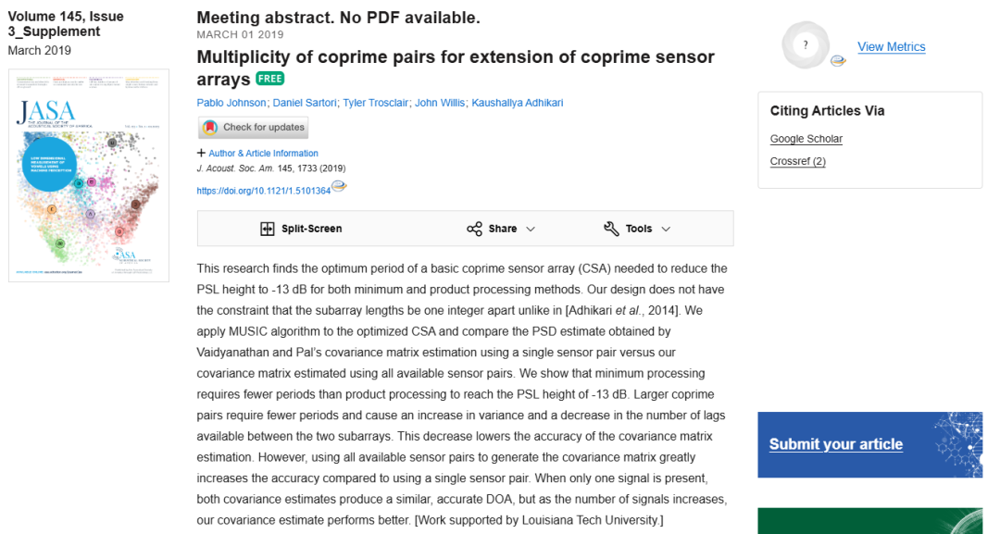
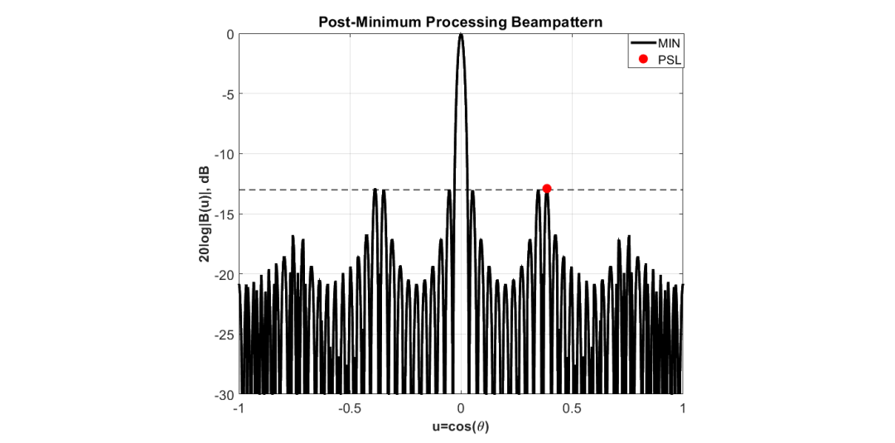
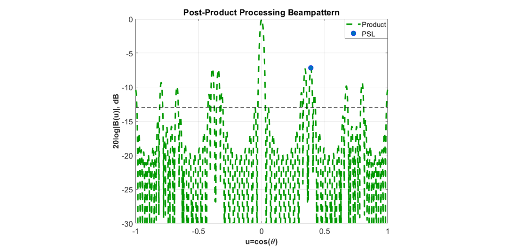
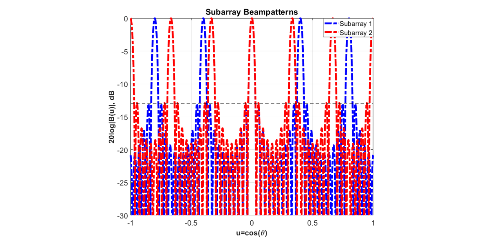
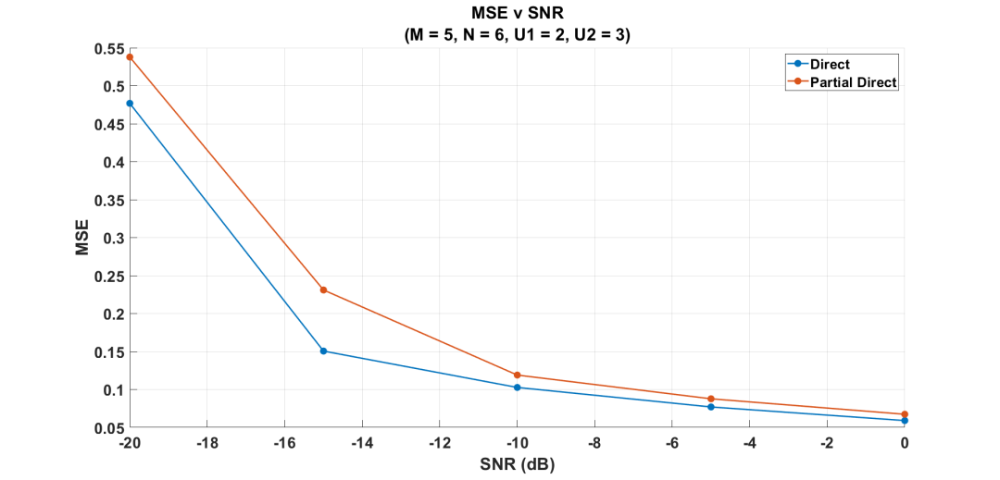
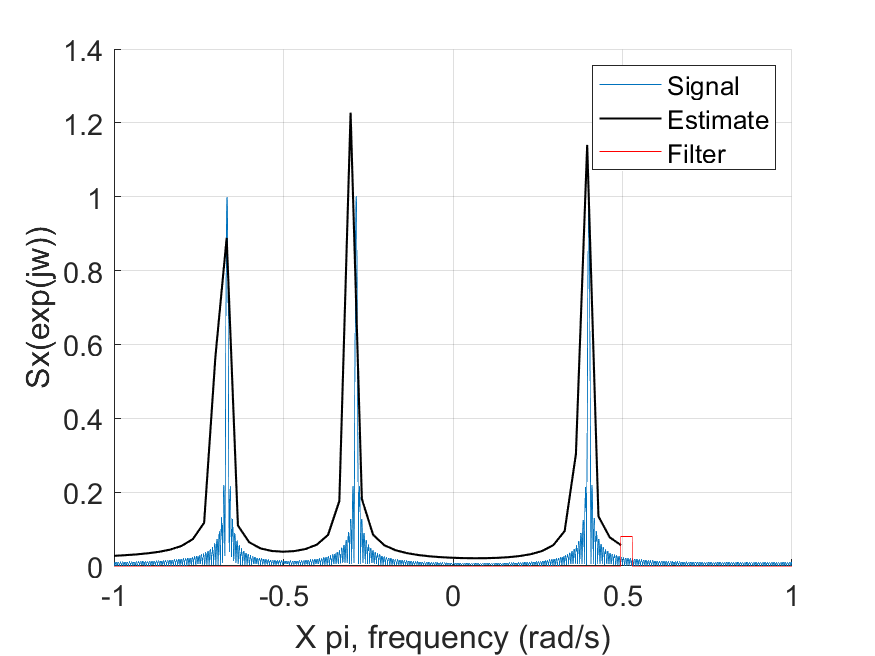
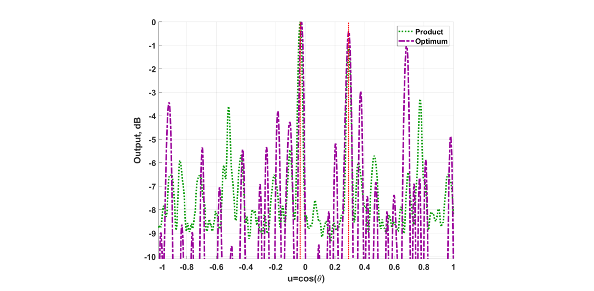
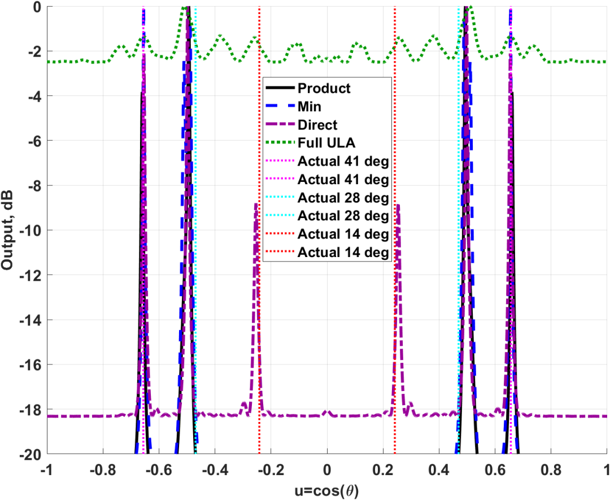

# Hearing Further and More Accurately: Optimized Design and High Precision Direction Finding Research of Sparse Coprime Arrays with MATLAB Codes

Listen Further, More Accurately: Optimized Design and High-Precision Direction Estimation Research on Sparse Interference Sensor Arrays - Exploring the Law of Array Layout and a New Method for Covariance Estimation 
In fields such as acoustic detection, radar monitoring, and wireless communication, how to utilize limited sensor resources to achieve high-precision direction of arrival (DOA) estimation has always been a focus of research. Although traditional uniform linear arrays are simple in principle, they often require a large number of sensor units, are costly, and complex. In recent years, "interference sensor arrays" have emerged as an efficient sparse array solution. 
This study conducts in-depth theoretical analysis and experimental verification on two major challenges faced by interference sensor arrays (CSA) in practical applications—array layout optimization design and signal processing accuracy improvement. The research not only proposes more flexible array layout rules but also significantly improves directional performance in multi-target environments through improved covariance estimation methods. 
1. Breakthrough in Array Design: Overcoming Constraints and Seeking Continuity in Interference Arrays lies in utilizing two sub-arrays with interfequent sampling intervals to expand the array aperture through "virtual" sensor positions. However, traditional array design often imposes strict constraints, such as requiring the lengths of the sub-arrays to differ by a specific integer, which to some extent limits the flexibility of design. 
1. Flexible Periodic Expansion Rules This study breaks away from the rigid constraints of traditional design, discovering through extensive numerical testing that there is a specific periodic expansion rule for the layout optimization of interference arrays. 
The research found that to ensure the array can obtain continuous virtual observation aperture (i.e., "co-array" continuous without holes), the length of the sub-arrays and the undersampling factor must follow a specific multiple relationship. Simply put, by following the basic interfequent pairs for periodic expansion, it ensures all possible sensor pair positions can be utilized, thus achieving the maximum continuous observation range. This finding provides clear mathematical guidance for finding the optimal array configuration within a fixed aperture.
2. The "Golden Ratio" for Reducing Sidelobes in Array Optimization
In array optimization, the Peak Sidelobe Level (PSL) is an important metric for measuring interference resistance. Through systematic analysis, the research team found that both "minimum value processing" and "production processing" algorithms have specific cycle extension ratios that can stably suppress PSL height below -13dB.
Interestingly, the results show that the array period required to achieve this excellent metric with "minimum value processing" is shorter. This means that under the same performance requirements, using "minimum value processing" can design smaller, more compact array structures, which is of great significance for embedded systems and mobile devices.
II. Signal Processing Innovation: From "Individual Battles" to "All-Member Collaboration"
Array design is just the first step; how to process the collected signal data is equally crucial. When using the classic MUSIC algorithm for direction finding, the accuracy of the covariance matrix estimation directly determines the reliability of the result.
Limitations of traditional methods in traditional mutually disjoint array signal processing rely on a single sensor pair. Although this "individual battle" approach is computationally simple, it has low information utilization efficiency when dealing with multiple signal sources or environments with low SNR, leading to increased estimation errors and even missed targets.
Innovative "Full Data Fusion" Estimation Method
This study proposes an innovative method: using all available sensor pairs to estimate the covariance matrix. Unlike traditional methods that only take sensor pairs at a specific distance, the new method averages the weighted information of all possible sensor pairings in the array.
Simulation analysis shows that this "all-member collaboration" method greatly improves the accuracy of the covariance matrix:
★ In a single signal source scenario: Both methods perform equally well, accurately determining the direction.
★ In a multi-signal source scenario: The new method significantly outperforms the old one. When there are multiple incident signals in the environment, traditional methods easily produce false peaks or directional ambiguity, while the new method can clearly and accurately distinguish the positions of all signal sources, significantly enhancing robustness.
3. Simulation and Measurement Verification: Data Speaks
To verify the above theories and methods, the research team conducted extensive computer simulation analysis and physical experiment verification.
1. Multi-dimensional Simulation Analysis in the Variation of Mean Square Error (MSE) with Signal-to-Noise Ratio (SNR) and Number of Sampling Points showed that the algorithm using an improved covariance estimation method exhibited excellent convergence characteristics. Even at lower signal-to-noise ratios, the optimized array layout combined with the new algorithm could still maintain low directional error.
2. Real-world Data Verification The research did not stop at the theoretical level; the team also built a physical experimental platform containing 64 microphone channels and conducted real data collection and processing in a soundproof room environment.
★  
Data Preprocessing: In response to the characteristics of real-world data, a specialized data reordering and filtering algorithm was developed, effectively eliminating edge noise and invalid frequency bands, ensuring the quality of the input signal.
★  
Result Comparison: The real-world results showed that the optimized designed mutually orthogonal array performed stably under real noise conditions, and the newly proposed covariance estimation method successfully separated multiple source directions from complex acoustic field data, highly matching the simulation conclusions, proving the practical application value of this technology.
4. Conclusion and Prospect This study systematically solved the core challenges in the design and signal processing of mutually orthogonal sensor arrays.
★  
Design Level: It clarified the rules of array period extension, pointed out the efficiency advantage of "minimum value processing" in suppressing sidelobes, providing a theoretical basis for the design of low-cost, high-performance sparse arrays.
★  
Algorithm Level: The proposed covariance estimation method based on full sensor pair fusion significantly enhanced the resolution capability and accuracy of the MUSIC algorithm in multi-target environments.
This research not only enriches the theoretical system of sparse array signal processing but also provides new ideas for array design in fields such as radar, sonar, wireless communication. In the future, this technology is expected to be applied in intelligent hearing aids, drone obstacle avoidance radar, and new generation mobile communication base station antenna design, allowing smart devices to "hear" further and more accurately within limited hardware conditions.
The core research findings of this article come from the research project of the Department of Electronic Engineering at Louisiana Tech University, led by Professor Kaushallya Adhikari. The team includes Pablo Johnson, Daniel Sartori, Tyler Trosclair, John Willis, and others.

## Images

<!-- PAYMENT_BLOCK -->

## Get this dataset

- Payment link (Stripe): [Buy now](https://buy.stripe.com/3cs8yP7sY87d0vu9AB)
- Payment QR code: 

<!-- /PAYMENT_BLOCK -->
